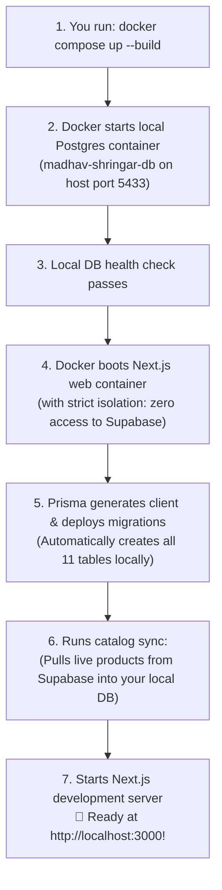
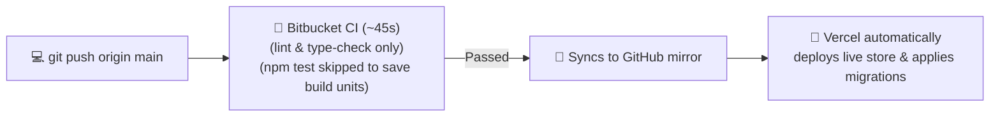

# 🚀 Madhav Shringar — Simple Deployment & Docker Guide

This guide explains in simple, plain English **what happens when you run `docker compose up --build`**, how the local database works, and how code deploys to the live website.

---

## ⚡ 1. The 2 Main Commands You Need

| Action | What to Run | What it Does |
| :--- | :--- | :--- |
| **Start Application** | `docker compose up --build` | Starts your local database, sets up all tables, syncs catalog, and boots the website on [http://localhost:3000](http://localhost:3000). |
| **Stop Application** | `docker compose down` | Safely stops all containers. Your data is saved in a persistent volume and will still be there next time! |

---

## 🔍 2. What Happens When You Run `docker compose up --build`?

Here is the exact step-by-step journey from the moment you press Enter:



### The 5 Simple Steps Explained:

1. **Starts the Database (`madhav-shringar-db`):**  
   Docker starts an isolated PostgreSQL database inside a container on host port **`5433`**. This ensures it never clashes with any existing database on your computer.
2. **Waits for Database to be Ready:**  
   Docker checks that the database is healthy before starting Next.js.
3. **Applies Database Tables (Migrations):**  
   Prisma runs `npx prisma migrate deploy` inside the container. It creates all tables (`Product`, `User`, `Order`, `Banner`, `BlogPost`, `Wishlist`, etc.) automatically.
4. **Downloads Real Products (Sync):**  
   It runs `npm run db:sync:catalog`. If you added `PROD_DATABASE_URL` in your `.env`, it connects to Supabase in **read-only mode** and downloads your live store products into your local database!
5. **Boots the Website:**  
   Next.js launches at **`http://localhost:3000`**. You can now test, add items to cart, and browse your store locally.

---

## 🛡️ 3. Why Your Production Database is 100% Safe

* **Zero Overwrite Risk:**  
  Your local app only connects to `DATABASE_URL=postgresql://...db:5432...`. 
* **Quarantined Testing:**  
  Any test orders, fake users, or test products you create on `localhost:3000` stay **strictly inside your local Docker container**. They never touch your live website.
* **Read-Only Catalog Sync:**  
  When syncing products from Supabase, the script only uses `SELECT` queries. It is physically impossible for local Docker commands to delete or alter live production records.

---

## 🗺️ 4. How Code Moves to Production (Pushing to `main`)

When you are happy with your changes and push to Bitbucket:



1. **You push to Bitbucket:**  
   ```bash
   git push origin main
   ```
2. **Bitbucket Pipelines runs fast checks (~45 seconds):**  
   It runs `npm run lint` and `npm run type-check`. `npm test` is excluded from automatic runs to save your monthly build minutes.
3. **Bitbucket mirrors code to GitHub:**  
   Transfers the verified commit safely.
4. **Vercel deploys to Production:**  
   Vercel applies any pending database migrations to Supabase via our smart build runner and publishes the new site live to **[https://www.madhavshringaar.com](https://www.madhavshringaar.com)**.

---

## 📦 5. How to Take Backups & Restore

### Take a Snapshot Backup:
```bash
npm run db:backup
```
* Saves a dated backup file into `./backups/`.
* Computes a SHA-256 integrity checksum.
* Keeps the last 7 backups and deletes older ones automatically.

### Restore if Production Ever Fails:
* **Option 1 (Easiest):** Open [Supabase Dashboard](https://supabase.com/dashboard) > **Database** > **Backups** > 1-click restore.
* **Option 2 (CLI):** Run `npm run db:restore` to restore to your local database or disaster recovery target.

---

## 🔄 6. Emergency Rollback

If you ever need to undo a live release:
1. **Instant Rollback (< 2 seconds):**  
   Open the **Vercel Dashboard > Deployments**, click the `...` menu on the last working release, and select **"Instant Rollback"**.
2. **Revert in Git:**  
   ```bash
   git revert HEAD
   git push origin main
   ```
