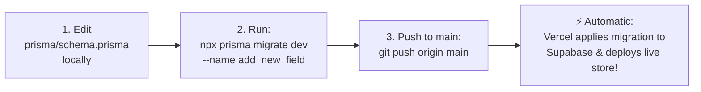

# 📖 Easy Step-by-Step Guide: Local Database, Production Sync & Backups

This guide explains in simple, clear steps how your local database and production Supabase database work together with **zero conflicts**, how your schema changes automatically synchronize to production when you push code to `main`, and how to take and restore backups.

---

## 🌟 The Core Rule: Local & Production Separation

* **Your Local Database**: Runs inside Docker on port `5433` (`shringaarwebsite`). Everything you do here (adding mock products, testing checkout, creating test users) stays **strictly on your computer**.
* **Your Production Database**: Hosted securely on Supabase. It holds live customer data, actual orders, and payments.
* **You DO NOT need the production Supabase URL on your local PC to develop!**  
  You can work, test, and build features completely offline with zero risk of breaking or touching production.

---

## 🚀 How Changes Sync to Production Automatically (3 Easy Steps)

When you want to add a new table, new column, or change an existing field in the database, here is the exact effortless workflow:



### Step 1: Update your local schema
Open `prisma/schema.prisma` and make your change (for example, adding a new field to `Product`):
```prisma
model Product {
  // ... existing fields ...
  newBadge   String?   // your new field
}
```

### Step 2: Create a versioned migration locally
Run this single command in your terminal:
```bash
npx prisma migrate dev --name add_new_badge
```
Prisma will:
1. Update your local Docker database immediately.
2. Create a timestamped SQL migration file in `prisma/migrations/`.

### Step 3: Commit and push to `main`
```bash
git add .
git commit -m "feat: add new badge field to product"
git push origin main
```

### 🎉 What Happens Automatically Behind the Scenes:
1. **Bitbucket Pipelines** validates code quality (`lint` and `type-check`) without wasting build minutes.
2. Bitbucket syncs your commit to the GitHub mirror.
3. **Vercel** triggers the production build. Vercel **already has your secure Supabase credentials** (`ms_POSTGRES_PRISMA_URL` and `DIRECT_URL`) stored in its project settings.
4. Our smart build runner automatically executes:
   ```bash
   npx prisma migrate deploy
   ```
   This applies **only your new migration** to Supabase cleanly and errorlessly before building Next.js!
5. If the migration succeeds, Vercel deploys the new website. If there's an error, Vercel cancels the build and your live store stays online safely with zero downtime.

---

## 🔍 Where is the Supabase Production URL?

You don't need this for daily coding, but if you ever need it for manual backups, you can find it in **two easy places**:

### Place 1: Inside your Vercel Dashboard (Easiest)
1. Go to [https://vercel.com](https://vercel.com) and click on your **`madhav-shringar`** project.
2. Click **Settings** (top navigation) > **Environment Variables** (left sidebar).
3. Find **`ms_POSTGRES_PRISMA_URL`** or **`DIRECT_URL`** and click the eye icon 👁️ to reveal it.

### Place 2: Inside your Supabase Dashboard
1. Go to [https://supabase.com/dashboard](https://supabase.com/dashboard) and select your project.
2. Click the **Project Settings** (gear icon) > **Database**.
3. Under **Connection String**, select **URI** (Session pooler port 5432 or 6543).

---

## 📦 How Production Backups Work

We have established a **dual-layer backup strategy** to guarantee your store data is never lost:

### Layer 1: Automatic Daily Backups (Already Active in Supabase)
* Supabase automatically creates daily snapshots of your database.
* **To check or restore:**
  1. Open [Supabase Dashboard](https://supabase.com/dashboard) > **Project Settings** > **Database** > **Backups**.
  2. You will see scheduled daily backups. You can restore any backup with **1-click**.

### Layer 2: Local Snapshot Backup Script
If you add your `PROD_DIRECT_URL` to your local `.env`, you can generate an independent offline backup anytime:
```bash
npm run db:backup
```
* **Output:** Creates a dated backup file in `./backups/` (e.g., `backup_20261027_105252.sql` or `.json`).
* **Integrity:** Generates a `.sha256` checksum file to guarantee data was not corrupted.
* **Retention:** Automatically keeps the last 7 backups and deletes older ones to save disk space.
* **Git Safe:** The `./backups/` directory is ignored by Git so backups are never leaked to public repositories.

---

## 🔄 Disaster Recovery: How to Restore Data

If production ever experiences an issue and you need to restore from a backup:

### Method A: 1-Click Restore in Supabase (Recommended)
1. Go to Supabase Dashboard > **Database** > **Backups**.
2. Select the date/time you want to roll back to.
3. Click **Restore**.

### Method B: Using the Included CLI Restore Script
```bash
# To restore to local database:
npm run db:restore

# To restore to production (Requires explicit typed confirmation):
npx ts-node scripts/restore-db.ts ./backups/backup_YOUR_DATE.sql --target-url="<YOUR_SUPABASE_DIRECT_URL>"
```
> [!CAUTION]
> The restore script has a safety lock: If the target is Supabase, it will pause and require you to type **`CONFIRM_PRODUCTION_RESTORE`** before writing anything.

---

## 📋 Everyday Developer Cheat Sheet

| Task | Command | What it Does |
| :--- | :--- | :--- |
| **Start local app + local DB** | `docker compose up --build` | Runs local Postgres on port 5433 and Next.js on port 3000. |
| **Stop local app** | `docker compose down` | Stops containers without losing your local database data. |
| **Create a schema change** | `npx prisma migrate dev --name <name>` | Generates a migration file and applies it to your local DB. |
| **Push changes to live store** | `git push origin main` | CI checks code, Vercel automatically applies migration to Supabase. |
| **Take a database backup** | `npm run db:backup` | Generates a timestamped backup in `./backups/` with checksum. |
| **Populate local store with live items** | `npm run db:sync:catalog` | Safely pulls live products/banners to your local DB without touching customer data. |
| **Check migration status** | `npm run db:migrate:status` | Shows which migrations have been applied and which are pending. |
